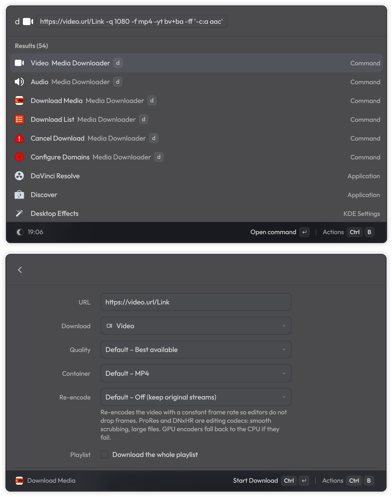

# [](https://github.com/Woysful/FFcut/releases) Media Downloader [Vicinae extension]

A [yt-dlp](https://github.com/yt-dlp/yt-dlp) based downloader for [Vicinae](https://github.com/vicinaehq/vicinae): video and audio from YouTube and hundreds of other sites, with per-site settings.



> Originally a port of a plugin made for [Flow Launcher](https://github.com/woysful/media-downloader-FlowLauncher).

## Features

- Quick commands that take a URL plus optional keys, and a **Download Media** form with every option
- Downloads keep running when you close Vicinae or start another command. Their progress stays visible in a desktop notification and in **Download List**
- Download single video or whole playlist
- Re-encoding Video or Audio stream after downloading the file
- Per-domain settings file
- yt-dlp and ffmpeg are downloaded automatically when they are not installed (ffmpeg: Linux x64/arm64), and the downloaded yt-dlp is kept up to date
- Login cookies from your browser, including Zen: `-c zen`

## Installation

Download [`media-downloader.tar.gz`](https://github.com/Woysful/Media-Downloader-Vicinae/releases/latest/download/media-downloader.tar.gz), extract it and put the `media-downloader` folder into the extensions folder.

Or build it yourself:

```bash
git clone https://github.com/Woysful/Media-Downloader-Vicinae.git
cd ./Media-Downloader-Vicinae
npm install
npm run build
```

> The extension is built to `~/.local/share/vicinae/extensions/media-downloader/`

## Commands

| Command | What it does |
|:--|:--|
| `Video` | Downloads a video using your settings (keys > domain rule > preferences) |
| `Audio` | Downloads audio and converts it to the chosen format |
| `Video Best` | Best quality, original codecs and container, no remux |
| `Audio Best` | Best audio, converted to WAV |
| `Download Media` | Form with all options. Shows which domain rule and settings will be used, live status and a cancel action |
| `Download List` | Running and recent downloads with live progress. Cancel, open the file or its folder, download again, copy the error, open the log |
| `Cancel Download` | Stops every running download of this extension (only its own yt-dlp/ffmpeg processes) and removes partial files |
| `Configure Domains` | Opens `domain-config.txt`, creating it with documentation first |

## Keys

Type keys after the URL (or before it). Values with spaces must be quoted, with `'single'` or `"double"` quotes.

| Key | Long form | Description | Example |
|:--|:--|:--|:--|
| `-f` | `--format` | Video container, or audio format for `Audio` | `-f mkv`, `-f mp3` |
| `-q` | `--quality` | Maximum video height | `-q 1080` |
| `-yt` | `--yt-dlp` | yt-dlp format selector | `-yt 'bv*[vcodec^=avc1]+ba/b'` |
| `-ff` | `--ffmpeg` | ffmpeg arguments for merging/remuxing (audio: extraction; `-e`/`-ea`: appended to the encoder arguments) | `-ff '-c:a aac'` |
| `-a` | `--args` | Any extra yt-dlp arguments | `-a '--limit-rate 5M'` |
| `-p` | `--playlist` | Download the whole playlist | `-p` |
| `-e` | `--edit`, `--reencode` | Re-encode the video for editors with a constant frame rate. Optional codec, see below | `-e`, `-e prores`, `-e off` |
| `-ea` | `--audio-encode`, `--audio-reencode` | Re-encode the audio track of a video. Optional codec, see below | `-ea`, `-ea pcm`, `-ea off` |
| `-c` | `--cookies` | Use the login cookies of a browser for this download, see [Cookies](#cookies) | `-c firefox`, `-c zen`, `-c zen:Work`, `-c off` |

Video re-encode codecs: `h264`, `h265`, `av1`, `prores`, `dnxhr`, `h264-nvenc`, `h265-nvenc`, `av1-nvenc`, `h264-vaapi`, `h265-vaapi`, `av1-vaapi`.
Audio re-encode codecs: `aac`, `opus`, `mp3`, `flac`, `pcm`. Audio re-encoding copies the video stream and keeps the chosen container unless video re-encoding is also enabled.
`-e` and `-ea` without a codec use H.264 and AAC when the preferences are set to No re-encode.

Audio that is already in the chosen codec is not encoded again, since a second lossy pass only loses quality: YouTube's Opus audio with the Opus preset, a repeated download, an AAC source with AAC. With audio re-encoding alone the file is left untouched; together with video re-encoding the audio is copied. The check looks at every audio track with ffprobe and compares the codec only, so bitrate presets are not enforced. Giving your own audio arguments (`-ff '-b:a 96k'`, `-ar`, `-af`, ...) turns the shortcut off and always encodes.

`Video Best` and `Audio Best` accept `-p`, `-a` and `-c`.

> **Example:** `https://youtube.com/watch?v=... -q 1080 -f mp4 -ff '-c:a aac'`

### Cookies

Cookies let yt-dlp act as you: age-restricted, private and members-only videos, "Sign in to confirm you're not a bot".

- `-c firefox` uses that browser for this download, even when cookies are off in the preferences. Supported: `firefox`, `zen`, `chrome`, `chromium`, `brave`, `edge`, `opera`, `vivaldi`, `safari`, `whale`.
- `-c` without a browser uses the one from the domain rule or the **Cookies From Browser** preference.
- `-c off` turns cookies off for this download.
- A profile can be named like in yt-dlp: `-c chrome:'Profile 1'`, `-c firefox:/path/to/profile`.

### Playlists

Without `-p` only one video is downloaded, even from a link like `watch?v=...&list=...`. For a link that points to a playlist only, the first item is downloaded and the status tells you to add `-p`.

With `-p` the files go into a folder named after the playlist: `Playlist Title/001 - Video Title.mp4`. Both templates can be changed in the preferences.

## Preferences

| Preference | Notes |
|:--|:--|
| Download Directory | Empty means your XDG download folder (usually `~/Downloads`) |
| Video Container, Video Quality, yt-dlp Video Format | Defaults for `Video` |
| Video Re-encode, Audio Re-encode, Re-encode Extra Arguments | See above. No re-encode leaves that stream untouched by default |
| Audio Format, Audio Quality | Defaults for `Audio` |
| Embed metadata / thumbnail | Thumbnails are embedded only into containers that support cover art |
| Cookies From Browser | Browser to take login cookies from by default (Zen is supported). `-c` overrides it per download, `-c off` disables it |
| Extra yt-dlp Arguments | Added to every download |
| File Name Template, Playlist File Name Template | yt-dlp output templates |
| Domain Config Directory | Empty means `~/.config/media-downloader/` |
| yt-dlp / ffmpeg Executable | Custom binaries. Empty means `PATH`, then the downloaded copy |
| Update the downloaded yt-dlp daily | Only affects the copy downloaded by the extension |
| Progress | One desktop notification updated with the progress while the download runs (Linux, needs `notify-send` from libnotify) |
| Desktop notification, Show the file in the file manager | What happens when a download finishes |

## Domain configuration

The file is created automatically on first use, in `~/.config/media-downloader/domain-config.txt` or in the **Domain Config Directory**. Run **Configure Domains** to open it.

**Priority order:** keys typed after the URL → domain config → preferences → built-in defaults.

```
# domain1, domain2: key="value" key='value' ...
youtube.com, youtu.be: quality="1080" format="mp4"
music.youtube.com: audio-format="mp3"
instagram.com: reencode="on"
twitch.tv: reencode="prores"
tiktok.com: audio-reencode="aac"
twitter.com, x.com: format="mp4"
vimeo.com: yt-dlp="bv*+ba/b" cookies="firefox"
youtube.com: quality="1080" cookies="zen"
```

| Key | Meaning |
|:--|:--|
| `yt-dlp` | Format selector for video |
| `format` | Video container |
| `quality` | Maximum video height |
| `ffmpeg` | ffmpeg arguments for merging/remuxing video |
| `reencode` | `on` (codec from the preferences), `off` or a codec name from the table above |
| `audio-reencode` | `on` (audio codec from the preferences), `off` or `aac`, `opus`, `mp3`, `flac`, `pcm` |
| `audio-format` | Format for the `Audio` command |
| `audio-ffmpeg` | ffmpeg arguments for audio extraction |
| `cookies` | Browser for login cookies: `firefox`, `zen`, `zen:Work`, ... `on` uses the browser from the preferences, `off` never uses cookies for the domain |
| `args` | Extra yt-dlp arguments |

A domain also matches its subdomains, and the most specific rule wins, so `music.youtube.com` overrides `youtube.com`. Only that one rule is used, so keep all keys for a site on one line. Unknown keys and invalid values are reported in the Vicinae extension log and ignored. See [`domain-config-example.txt`](domain-config-example.txt) for more examples.

## Troubleshooting

- **HTTP Error 403, "Sign in to confirm", age-restricted videos:** update yt-dlp, or use cookies: `-c firefox`, `-c zen`, or the **Cookies From Browser** preference.
- **"could not find firefox cookies database" with Zen:** choose **Zen** (or `-c zen`), not Firefox. If Zen is installed in an unusual place, pass the profile folder: `-c zen:/path/to/profile`.
- **"module mutagen was not found":** yt-dlp needs mutagen to embed a thumbnail into opus/ogg/flac. The extension switches to the standalone yt-dlp for such downloads by itself. If you set a custom **yt-dlp Executable**, it is left alone: the download works, the thumbnail is skipped and the result says so. Install mutagen for that yt-dlp (`python3 -m pip install mutagen`, or `sudo pacman -S python-mutagen`) or clear the preference.
- **"Requested format is not available":** your `-yt` selector or the domain rule's `yt-dlp` value matches nothing on that site. Try without it.
- **Container errors after changing `-f`:** remuxing only changes the container, so codecs must be supported by it (for example, VP9 in AVI is not). Use MP4/MKV, or `-e`.
- **Re-encode is slow:** pick a GPU codec (`h264-nvenc`, `h264-vaapi`) or add `-ff '-preset fast'`. ProRes and DNxHR are fast to encode but produce very large files.
- **Audio re-encode fails in some containers:** WebM accepts Opus, while MP4/MOV accept AAC and MP3; PCM is safest in MOV or MKV. MKV accepts every audio codec offered here.
- **The status disappears when Vicinae closes:** Vicinae removes its own status when the window is closed. The download keeps running; follow it in the progress notification or in **Download List**.
- **Logs:** each download keeps its yt-dlp output for 3 days in the extension support folder, usually `~/.local/share/vicinae/support/media-downloader/jobs/<id>/output.log`.

## Development

```bash
npm install
npm run dev        # vici develop
npm test           # parser, plan and runner tests
npm run typecheck
```

Downloads are run by `assets/runner.js`, a small standalone Node script started in its own process group. It runs yt-dlp (and the optional ffmpeg re-encode), updates the progress notification and writes `state.json`, which the commands read to show progress.
